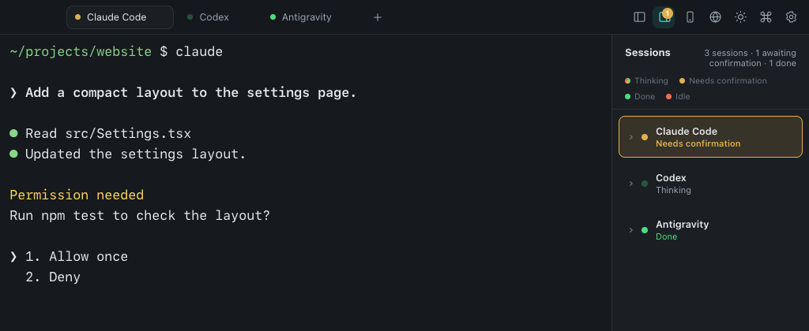
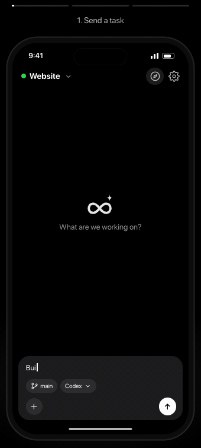

# Byline

**English** · [简体中文](./README.zh-CN.md)

**Byline is a macOS terminal for working with AI coding agents.**

Run Claude Code, Codex, and Antigravity CLI in separate tabs. See who's working, who's waiting for your approval, and who's finished. Pair Byline with the SuperDev app to send tasks to your Mac and follow them from your phone.

**[Download for Mac][download]** · [Release notes][releases] · [SuperDev website][website]



## Work with agents on your Mac

- **See which session needs you.** Tabs and the Sessions sidebar show live status. An approval request in a background tab lights up so you can jump straight to it.
- **Hand work from Claude Code to Codex, or back.** Right-click a running session and choose **Hand off to Codex…** or **Hand off to Claude…**. Byline opens a new tab for the receiving agent with a summary and the saved transcript.
- **Keep your usual shell setup.** Each tab runs your login `zsh`, with your `.zshrc`, prompt, completions, `vim`, and `ssh`.

## Send a task from your phone

In this demo, a request from SuperDev starts Codex in a project tab on the Mac. SuperDev shows its progress and opens the finished page on the phone.



1. On your Mac, open **Connect phone** in Byline's toolbar and click **Turn on** to generate a QR code.
2. In SuperDev on Android or iPhone, scan the code and confirm your Mac. [Join SuperDev early access][early-access] for the companion app.
3. Pick a project and an agent, then send a task. You can attach screenshots or files and follow the agent's steps and replies as it works on your Mac.

Keep the Mac awake and Byline running. SuperDev connects directly on the same Wi-Fi. To connect away from home, pair after Byline shows an HTTPS relay address in the pairing panel.

## Install Byline

Byline is free to use and runs on macOS 11 or later, on Apple silicon and Intel Macs. The [signed and notarized DMG][download] includes both architectures. Open it and drag Byline into Applications.

You can also install it with Homebrew.

```sh
brew install --cask by123/tap/byline
```

On first launch, Byline checks for Claude Code, Codex CLI, and Antigravity CLI (`agy`). Choose the tools you want to install and sign in to the ones you use. **Preferences → AI command-line tools** shows their status and lets you retry an installation.

[download]: https://github.com/by123/byline-releases/releases/latest/download/Byline.dmg
[releases]: https://github.com/by123/byline-releases/releases
[website]: https://by666.cn/
[early-access]: https://by666.cn/#early
