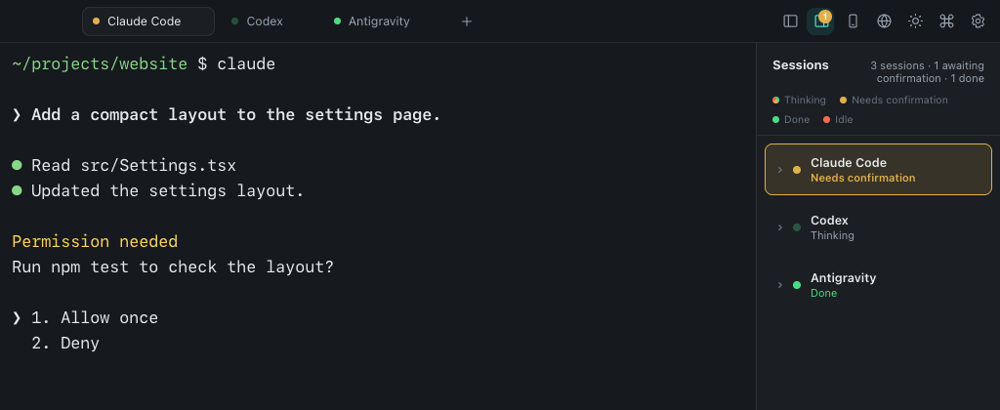
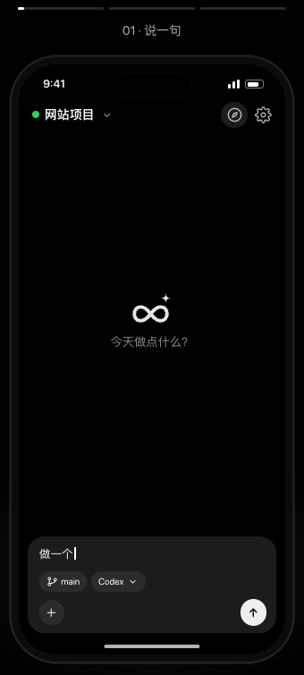

# Byline

[English](./README.md) · **简体中文**

**Byline 是一个用来管理 AI 编程会话的 macOS 终端。**

把 Claude Code、Codex 和 Antigravity CLI 分别开在不同的标签页里，一眼看清谁在做、谁在等你确认、谁已经做完。配上 SuperDev 手机 App，出门也能给 Mac 派活、看进度和结果。

**[下载 Byline][download]** · [版本更新][releases] · [SuperDev 官网][website]



## 在 Mac 上管理会话

- **看看哪个会话需要你。** 标签页和「会话」侧栏实时显示状态。后台会话需要确认时，对应标签会亮起来，点过去就能处理。
- **把做到一半的任务交给另一个助手。** 右键正在运行的 Claude Code 或 Codex 会话，选「移交给 Codex…」或「移交给 Claude…」。接手的助手会在新标签页里拿到摘要和保存的对话记录，继续做下去。
- **沿用你平时的终端配置。** 每个标签页都运行你的登录 shell `zsh`，照常加载 `.zshrc`，也能用原来的提示符、补全、`vim` 和 `ssh`。

## 用手机给 Mac 派活

下面演示的是用 SuperDev 发一个做网页的任务。Mac 在项目的 Byline 标签页里运行 Codex，手机上能看到每一步，做完直接打开网页预览。



1. 在 Mac 上打开 Byline，点标题栏的「连接手机」，再点「开启」生成二维码。
2. 在安卓或 iPhone 上打开 SuperDev，扫码并确认配对的 Mac。还没有手机 App，可以到官网[报名抢先体验][early-access]。
3. 选项目和助手，发一条任务。可以带上截图或文件，在手机上看助手在 Mac 上做过的步骤和回复。

保持 Mac 唤醒并让 Byline 运行。同一个 Wi-Fi 下可以直连。如果要在外面用，等 Byline 配对面板显示 HTTPS 中转地址后再扫码。

## 安装 Byline

Byline 免费使用，支持 macOS 11 及以上，适用于搭载 Apple 芯片或 Intel 处理器的 Mac。打开[已签名并公证的 DMG][download]，把 Byline 拖进「应用程序」。

也可以用 Homebrew 安装。

```sh
brew install --cask by123/tap/byline
```

第一次打开时，Byline 会检查 Claude Code、Codex CLI 和 Antigravity CLI（`agy`）。选择要安装的工具，在要用的工具里登录。之后可以在「偏好设置 → AI 命令行工具」查看状态或重试安装。

[download]: https://github.com/by123/byline-releases/releases/latest/download/Byline.dmg
[releases]: https://github.com/by123/byline-releases/releases
[website]: https://by666.cn/
[early-access]: https://by666.cn/#early
